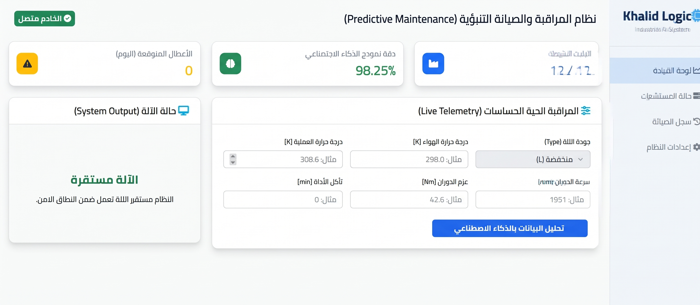

# ⚙️ Predictive Maintenance Using Machine Learning

[](https://www.python.org/)
[](https://flask.palletsprojects.com/)

An end-to-end Machine Learning web application designed to predict equipment and machine failures before they occur, reducing downtime and maintenance costs in industrial environments.

---

## 📌 Project Overview
This project implements classification models to predict machine failures using sensor readings from the **AI4I 2020 Predictive Maintenance Dataset**. 

<p align="center">
  
</p>

---

## 🚀 Key Features
- **Predictive Modeling**: Trained classification models to detect failure risks.
- **Interactive Web Interface**: Clean UI built with Flask for real-time predictions.
- **Robust Pipeline**: Automated feature scaling and preprocessing via Pickle (`.pkl`).

---

## 🛠️ Installation & Local Setup

### 1. Clone the Repository
```bash
git clone [https://github.com/khalidllogic/predictive-maintenance-ml.git](https://github.com/khalidllogic/predictive-maintenance-ml.git)
cd predictive-maintenance-ml                                                 
pip install -r requirements.txt
python app.py